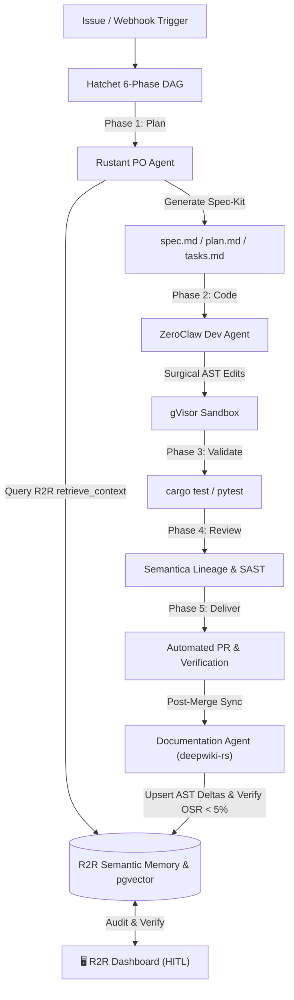

<h2 align="center">
R2R Dashboard
</h2>

<h3 align="center">
Manage and Monitor Your R2R RAG Applications with Ease
</h3>

# About

The R2R Dashboard is an open-source React+Next.js application designed to provide [R2R](https://github.com/lgcorzo/R2R-Engine) developers with an easy interface to interact with their pipelines. This dashboard aims to reduce development and iteration time by offering a user-friendly environment.

## Key Features

- **🗂️ Document Management**: Upload, update, and delete documents and their metadata.
- **🛝 Playground**: Stream RAG responses with different models and configurable settings.
- **📊 Analytics**: View aggregate statistics around latencies and metrics with detailed histograms.
- **📜 Logs**: Track user queries, search results, and LLM responses.
- **🔧 Development Tools**: Easily start a development server, format code, and run lint checks.

## Table of Contents

1. [Key Features](#key-features)
2. [Screenshots & Frontend Interface](#screenshots--frontend-interface)
3. [Dark Gravity Autonomous CA/CD Factory Integration](#-dark-gravity-autonomous-cacd-factory-integration)
4. [Quick Install](#quick-install)
5. [Developing with the R2R Dashboard](#developing-with-the-r2r-dashboard)
6. [Links & Documentation](#links)
7. [Summary](#summary)

---

# Screenshots & Frontend Interface

The R2R Dashboard provides a high-fidelity, responsive user interface built on Next.js 15, Tailwind CSS, and Radix UI primitives. Below are verified interface screenshots showing the primary operational views:

### 1. Interactive Agentic RAG Chat & Playground

Test multi-turn reasoning agents, stream responses in real-time, inspect thought blocks, and verify citation sources and similarity scores.

<p align="center">
  
</p>

- **Streaming Reasoning**: Real-time token streaming with collapsible agent thought processes (`ThinkingBlock`).
- **Citation Traceability**: Direct links to source chunks with cosine similarity distances and metadata.
- **Model & Parameter Tuning**: Switch LLM backends (LiteLLM, Azure OpenAI, Ollama), adjust temperature, and customize system prompts dynamically.

---

### 2. Document Management & Ingestion Center

Inspect, upload, partition, and monitor multimodal document ingestion pipelines.

<p align="center">
  
</p>

- **Multimodal Uploads**: Drag-and-drop support for `.pdf`, `.txt`, `.json`, `.png`, and structured codebases.
- **Ingestion Lifecycle Monitoring**: Real-time tracking of parsing, chunking, embedding, and vector storage phases.
- **Metadata & Filtering**: Filter by ingestion status, date, collection ID, or custom Open Knowledge Format (OKF) frontmatter tags.

---

### 3. Collection Governance & Knowledge Partitioning

Manage knowledge isolation, role-based access controls (RBAC), and logical boundaries across different projects or teams.

<p align="center">
  
</p>

- **Logical Knowledge Boundaries**: Group related documents into isolated vector collections.
- **Entity & Community Exploration**: Inspect community clusters and graph entities extracted during GraphRAG processing.
- **Access Control**: Assign granular user and service account permissions to individual collections.

---

### 4. Zero-Trust Authentication & Access Portal

Secure ingress backed by OAuth2 Proxy and OpenZiti zero-trust overlay.

<p align="center">
  
</p>

- **Enterprise Single Sign-On**: Seamless integration with OAuth2 / OIDC providers.
- **Role-Based Views**: Automatic UI capability pruning based on user permissions.

---

## 🏭 Dark Gravity Autonomous CA/CD Factory Integration

In the **Dark Gravity Autonomous CA/CD Software Factory (V7.2 / V7.3)**, the **R2R Dashboard** serves as the primary **Human-in-the-Loop (HITL) Mission Control & Semantic Memory Portal**. While autonomous agents execute code and planning pipelines headlessly, human engineers and automated supervisors utilize the dashboard to audit, inspect, and benchmark the factory's semantic corporate memory in real time.

<p align="center">
  
</p>

### 📐 Factory End Architecture & Deployment Topology

- **Kubernetes Ingress & Overlay Network**: Deployed inside the `llm-apps` namespace (`r2r-dashboard`) at `localhost:32000/r2r-dashboard:latest` and securely routed over the **OpenZiti zero-trust overlay network** (`https://r2r.ziti`).
- **Pod Hardening**: Configured with strict defense-in-depth controls:
  - `readOnlyRootFilesystem: true`
  - `runAsNonRoot: true` (UID: 1000)
  - `allowPrivilegeEscalation: false`
  - `capabilities.drop: ["ALL"]`
- **OAuth2-Proxy Sidecar**: Every request is intercepted by an authenticated `oauth2-proxy` sidecar container before reaching the Next.js runtime.
- **CloudNativePG & `pgvector` Backplane**: Connects to the high-availability CloudNativePG PostgreSQL 16 cluster (`mlflow-db`), routing read-heavy dashboard queries through dedicated read replicas (`r2r-read-replica-service`).

---

### ⚡ Factory End Use Cases & Agent Collaboration

The R2R Dashboard interfaces with the **Hatchet 6-Phase DAG** orchestrator:



#### How the Factory End Leverages the UI:

| Factory Subsystem           | Dashboard Role & Operational Pattern                                                                 | Key Benefit                                                                       |
| :-------------------------- | :--------------------------------------------------------------------------------------------------- | :-------------------------------------------------------------------------------- |
| **Human Operator (HITL)**   | Inspects **Collections** and **Documents** to review knowledge bases created by autonomous missions. | Guarantees quality gates and transparency over what agents read and reference.    |
| **Product Owner (Rustant)** | Verifies retrieval results in **Playground/Chat** before generating Spec Kit plans.                  | Prevents hallucination of obsolete APIs and deprecated internal methods.          |
| **Developer (ZeroClaw)**    | Visualizes AST deltas and dependency trees extracted by `deepwiki-rs`.                               | Validates that target symbols and blast radiuses match the codebase state.        |
| **QA & Sentry Observer**    | Cross-references Sentry crash stacktraces with R2R document chunks.                                  | Instantly isolates problematic source files and triggers autonomous hotfix tasks. |
| **FinOps & Governance**     | Monitors token metrics and query latencies across missions.                                          | Prevents runaway inference spend and enforces per-mission token budgets.          |

---

### 🔍 3-Level Context Pruning Verification

The dashboard allows operators to test and visualize the **3-Level Context Pruning Engine** used by factory agents to minimize LLM token bloat:

<p align="center">
  
</p>

1. **Semantic Filtering**: Visual inspection of cosine similarity thresholds on returned document nodes.
2. **Structural AST Pruning**: Verifying that retrieved nodes follow real code dependency paths (`depends_on`).
3. **Token Clamping**: Ensuring payloads stay within strict gVisor sandbox memory constraints (≤ 30 MiB RAM).

---

# Quick Install

### Install PNPM

PNPM is a fast, disk space-efficient package manager that helps you manage your project dependencies. To install PNPM, visit the [official PNPM installation page](https://pnpm.io/installation) for the latest instructions, or follow the instructions outlined below:

<details>
<summary>PNPM Installation</summary>

For Unix-based systems (Linux, macOS):

```bash
curl -fsSL https://get.pnpm.io/install.sh | sh -
```

For Windows:

```powershell
iwr https://get.pnpm.io/install.ps1 -useb | iex
```

After installing PNPM, you may need to add it to your system's PATH. Follow the instructions provided on the PNPM installation page to ensure it's properly set up.

</details>

### Clone the R2R Dashboard and Install Dependencies

1. **Clone the project repository and navigate to the project directory:**

   ```bash
   git clone git@github.com:lgcorzo/R2R-Application.git
   cd R2R-Application
   ```

2. **Install the project dependencies using PNPM:**

   ```bash
   pnpm install
   ```

3. **Build and start the application for production:**

   ```bash
   pnpm build
   pnpm start
   ```

This will build the application on port 3000. After `pnpm start` runs successfully, the dashboard can be viewed at [http://localhost:3000](http://localhost:3000).

### Developing with the R2R Dashboard

If you'd like to develop the R2R dashboard, you can do so by starting a development server:

1. **Start the development server:**

   ```bash
   pnpm dev
   ```

2. **Pre-commit checks (optional but recommended):**

   Ensure your code is properly formatted and free of linting issues before committing:

   ```bash
   pnpm format
   pnpm lint
   ```

# Links

- [Join the Discord server](https://discord.gg/p6KqD2kjtB)
- [R2R Docs Quickstart](https://r2r-docs.sciphi.ai/getting-started/quick-install)

## Docs

- [R2R Dashboard](https://r2r-docs.sciphi.ai/cookbooks/dashboard): A how-to guide on connecting with the R2R Dashboard.
- [R2R Demo](https://r2r-docs.sciphi.ai/getting-started/r2r-demo): A basic demo script designed to get you started with an R2R RAG application.
- [R2R Client-Server](https://r2r-docs.sciphi.ai/cookbooks/client-server): An extension of the basic `R2R Demo` with client-server interactions.
- [Local RAG](https://r2r-docs.sciphi.ai/cookbooks/local-rag): A quick cookbook demonstration of how to run R2R with local LLMs.
- [Hybrid Search](https://r2r-docs.sciphi.ai/cookbooks/hybrid-search): A brief introduction to running hybrid search with R2R.
- [Reranking](https://r2r-docs.sciphi.ai/cookbooks/rerank-search): A short guide on how to apply reranking to R2R results.
- [SciPhi Cloud Docs](https://docs.sciphi.ai/): SciPhi Cloud documentation.

# Summary

The R2R Dashboard is a comprehensive tool designed to streamline the management and monitoring of Retrieval-Augmented Generation (RAG) pipelines built with the R2R framework. By providing a user-friendly interface and robust core features, the dashboard helps developers and autonomous agent factories efficiently interact with their RAG systems, enhancing development and operational workflows.
