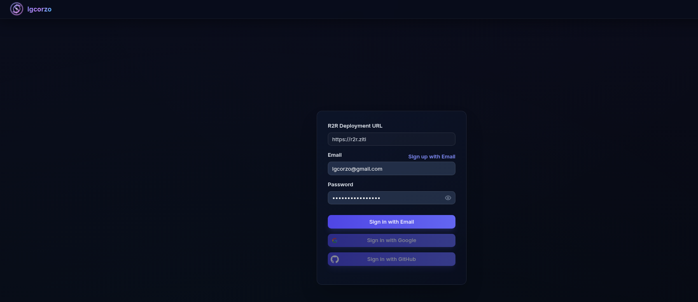
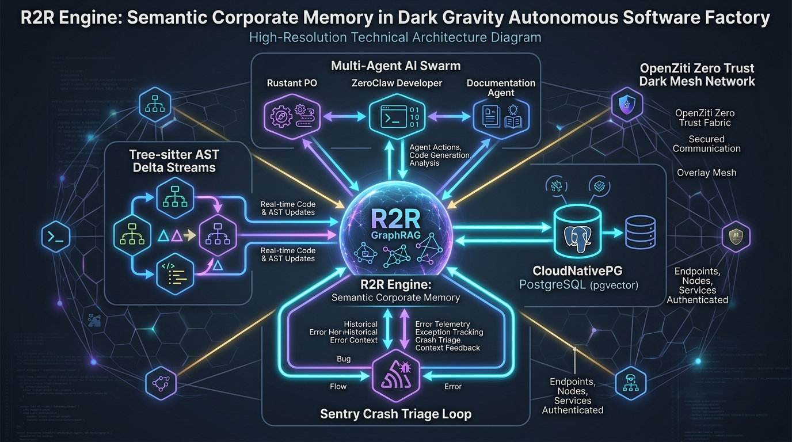
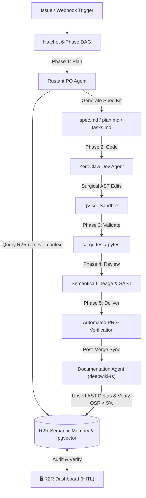
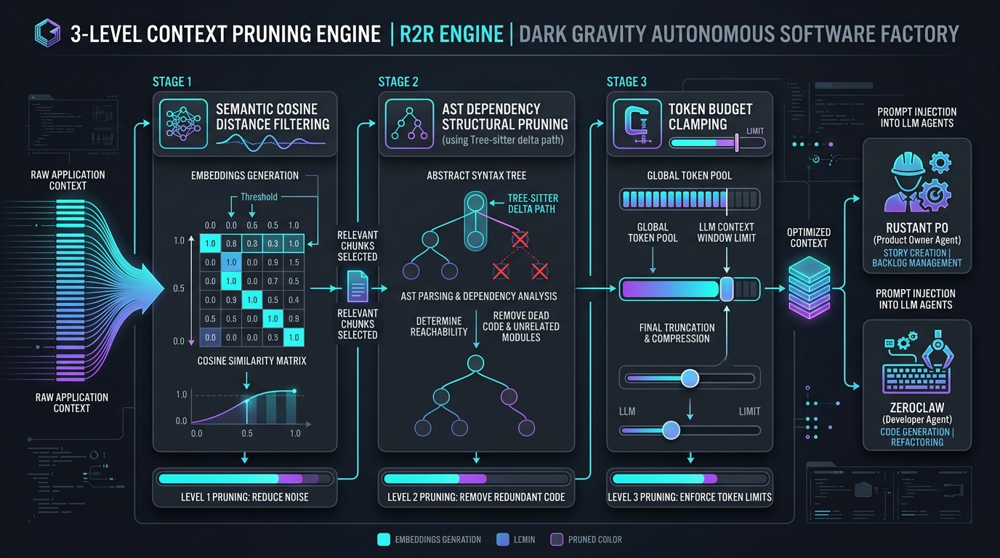

<h2 align="center">
R2R Dashboard & Developer Workbench
</h2>

<h3 align="center">
Next-Generation RAG Developer & Operations Workbench for R2R Pipelines
</h3>

# About

The R2R Dashboard is an open-source Next.js 15 & React application built for [R2R](https://github.com/lgcorzo/R2R-Engine). It has been upgraded into a unified **RAG Developer & Operations Workbench**, providing AI engineers, platform developers, and autonomous agent factories with a high-density environment to benchmark retrieval strategies, monitor multimodal ingestion pipelines, and inspect real-time engine telemetry.

## Key Features

- **⚔️ Retrieval Arena (`/arena`)**: Side-by-side A/B experimentation studio. Run queries simultaneously across two retrieval configurations (Dense Semantic, BM25, Hybrid RRF, Knowledge Graph), compare ranked chunks with visual diff badges (`[Also in B at #X]`, `[Unique to A]`), tune parameters in real-time, and trace collapsible agent reasoning steps (`ThinkingBlock`).
- **📚 3-Pane Knowledge Studio (`/knowledge`)**: Unified document explorer and ingestion control center. Features a hierarchical collection/document tree (Pane 1), a 5-stage ingestion lifecycle tracker (`Upload` ➔ `Parse` ➔ `Chunk` ➔ `Embed` ➔ `Enrich`) with virtualized chunk cards (Pane 2), and deep Chunk DevTools for vector dimensionality, token counts, and metadata JSON inspection (Pane 3).
- **⚙️ Telemetry & Operations Hub (`/ops`)**: Live system observability. Track pipeline latency percentiles (p50, p95, p99), monitor ingestion dead-letter queues with automated retry capabilities, review token consumption across models, and verify engine cluster health.
- **🧭 Developer Workbench Shell**: High-productivity workspace with an ultra-compact Activity Rail (56px), keyboard-first Command Palette (`⌘K` / `Ctrl+K`), and a persistent bottom diagnostics status bar displaying live latency, model backends, and cluster connectivity.
- **🛡️ Zero-Trust Security & Enterprise SSO**: Secure ingress over OpenZiti zero-trust overlay (`https://r2r.ziti`) backed by OAuth2 Proxy and multi-provider SSO (Google, GitHub, direct credentials).
- **🗂️ Document & Collection Governance**: Fine-grained role-based access control (RBAC), multi-tenant collection isolation, and multimodal file ingestion (`.pdf`, `.txt`, `.json`, `.png`, source code).

## Table of Contents

1. [Key Features](#key-features)
2. [Workbench Workspaces & Architecture](#workbench-workspaces--architecture)
3. [Screenshots & Frontend Interface](#screenshots--frontend-interface)
4. [Dark Gravity Autonomous CA/CD Factory Integration](#-dark-gravity-autonomous-cacd-factory-integration)
5. [Quick Install](#quick-install)
6. [Developing with the R2R Dashboard](#developing-with-the-r2r-dashboard)
7. [Links & Documentation](#links)
8. [Summary](#summary)

---

# Workbench Workspaces & Architecture

The workbench architecture consolidates administrative and developer workflows into three specialized workspaces, coordinated by an IDE-like shell:

```
┌──────┬───────────────────────┬────────────────────────────────────────────────────────┐
│ RAIL │ CONTEXT PANEL         │ MAIN WORKBENCH VIEWPORT                                │
├──────┼───────────────────────┼────────────────────────────────────────────────────────┤
│ ⚔️   │ • Presets Library     │ [ Active Viewport: Arena / Knowledge / Ops ]           │
│ 📚   │ • Saved Queries       │                                                        │
│ ⚙️   │ • Ingestion Filters   │                                                        │
│ 🌐   │ • Cluster Endpoints   │                                                        │
├──────┴───────────────────────┴────────────────────────────────────────────────────────┤
│ STATUS: Engine: Online (v3.7) │ Latency: 142ms │ Active Model: gpt-4o │ Hotkey: ⌘K     │
└───────────────────────────────────────────────────────────────────────────────────────┘
```

### 1. ⚔️ Retrieval Arena (`/arena`)

- **Dual Retrieval Viewports**: Simultaneous side-by-side execution of Configuration A vs Configuration B.
- **Visual Chunk Diffing**: Badges show overlapping chunks (`[Also in B at #X]`), unique discoveries (`[Unique to A]`), and rank shifts.
- **Dynamic Configuration Tuning**: Real-time adjustment of hybrid dense/sparse weights (BM25 vs Vector), reranker selection (Cohere, ColBERT), and Top-K limits.
- **Agent Trace Drawer**: Live inspection of streaming thought blocks, tool calls, and citation anchors.

### 2. 📚 3-Pane Knowledge Studio (`/knowledge`)

- **Pane 1 (Hierarchy)**: Filterable collection and document trees with ingestion status badges.
- **Pane 2 (Pipeline Tracker & Chunk Grid)**: Visual progress through `Upload` ➔ `Parse` ➔ `Chunk` ➔ `Embed` ➔ `Enrich` stages, plus virtualized chunk previews.
- **Pane 3 (Chunk DevTools)**: Low-level vector inspection, embedding similarity distributions, token counts, and live metadata editing.

### 3. ⚙️ Telemetry & Operations Hub (`/ops`)

- **Latency Percentiles**: Real-time p50, p95, and p99 latency metrics across retrieval, generation, and ingestion stages.
- **Dead-Letter Queue (DLQ)**: Ingestion error monitoring with full stack traces and surgical retry triggers.
- **Engine Diagnostics**: Cluster status, OpenZiti zero-trust connection health, and LLM token usage tracking.

---

# Screenshots & Frontend Interface

The R2R Dashboard provides a high-fidelity, responsive user interface built on Next.js 15, Tailwind CSS, and Radix UI primitives. Below are verified interface screenshots showing the primary operational views:

### 1. Interactive Agentic RAG Chat & Playground

Test multi-turn reasoning agents, stream responses in real-time, inspect thought blocks, and verify citation sources and similarity scores.

<p align="center">
  
</p>

- **Streaming Reasoning**: Real-time token streaming with collapsible agent thought processes (`ThinkingBlock`).
- **Citation Traceability**: Direct links to source chunks with cosine similarity distances and metadata.
- **Model & Parameter Tuning**: Switch LLM backends (LiteLLM, Azure OpenAI, Ollama), adjust temperature, and customize system prompts dynamically.

---

### 2. Document Management & Ingestion Center

Inspect, upload, partition, and monitor multimodal document ingestion pipelines.

<p align="center">
  
</p>

- **Multimodal Uploads**: Drag-and-drop support for `.pdf`, `.txt`, `.json`, `.png`, and structured codebases.
- **Ingestion Lifecycle Monitoring**: Real-time tracking of parsing, chunking, embedding, and vector storage phases.
- **Metadata & Filtering**: Filter by ingestion status, date, collection ID, or custom Open Knowledge Format (OKF) frontmatter tags.

---

### 3. Collection Governance & Knowledge Partitioning

Manage knowledge isolation, role-based access controls (RBAC), and logical boundaries across different projects or teams.

<p align="center">
  
</p>

- **Logical Knowledge Boundaries**: Group related documents into isolated vector collections.
- **Entity & Community Exploration**: Inspect community clusters and graph entities extracted during GraphRAG processing.
- **Access Control**: Assign granular user and service account permissions to individual collections.

---

### 4. Zero-Trust Authentication & Access Portal

Secure ingress backed by OAuth2 Proxy and OpenZiti zero-trust overlay (`https://r2r.ziti`).

<p align="center">
  
</p>

- **Zero-Trust Deployment (`https://r2r.ziti`)**: Hardened ingress routed via OpenZiti overlay network with configurable deployment endpoints.
- **Enterprise Single Sign-On (SSO)**: Flexible authentication supporting direct credentials alongside OAuth2 / OIDC providers (Google and GitHub).
- **Role-Based Views**: Automatic UI capability pruning based on user permissions and authenticated identity.

---

## 🏭 Dark Gravity Autonomous CA/CD Factory Integration

In the **Dark Gravity Autonomous CA/CD Software Factory (V7.2 / V7.3)**, the **R2R Dashboard** serves as the primary **Human-in-the-Loop (HITL) Mission Control & Semantic Memory Portal**. While autonomous agents execute code and planning pipelines headlessly, human engineers and automated supervisors utilize the dashboard to audit, inspect, and benchmark the factory's semantic corporate memory in real time.

<p align="center">
  
</p>

### 📐 Factory End Architecture & Deployment Topology

- **Kubernetes Ingress & Overlay Network**: Deployed inside the `llm-apps` namespace (`r2r-dashboard`) at `localhost:32000/r2r-dashboard:latest` and securely routed over the **OpenZiti zero-trust overlay network** (`https://r2r.ziti`).
- **Pod Hardening**: Configured with strict defense-in-depth controls:
  - `readOnlyRootFilesystem: true`
  - `runAsNonRoot: true` (UID: 1000)
  - `allowPrivilegeEscalation: false`
  - `capabilities.drop: ["ALL"]`
- **OAuth2-Proxy Sidecar**: Every request is intercepted by an authenticated `oauth2-proxy` sidecar container before reaching the Next.js runtime.
- **CloudNativePG & `pgvector` Backplane**: Connects to the high-availability CloudNativePG PostgreSQL 16 cluster (`mlflow-db`), routing read-heavy dashboard queries through dedicated read replicas (`r2r-read-replica-service`).

---

### ⚡ Factory End Use Cases & Agent Collaboration

The R2R Dashboard interfaces with the **Hatchet 6-Phase DAG** orchestrator:



#### How the Factory End Leverages the UI:

| Factory Subsystem           | Dashboard Role & Operational Pattern                                                                 | Key Benefit                                                                       |
| :-------------------------- | :--------------------------------------------------------------------------------------------------- | :-------------------------------------------------------------------------------- |
| **Human Operator (HITL)**   | Inspects **Collections** and **Documents** to review knowledge bases created by autonomous missions. | Guarantees quality gates and transparency over what agents read and reference.    |
| **Product Owner (Rustant)** | Verifies retrieval results in **Playground/Chat** before generating Spec Kit plans.                  | Prevents hallucination of obsolete APIs and deprecated internal methods.          |
| **Developer (ZeroClaw)**    | Visualizes AST deltas and dependency trees extracted by `deepwiki-rs`.                               | Validates that target symbols and blast radiuses match the codebase state.        |
| **QA & Sentry Observer**    | Cross-references Sentry crash stacktraces with R2R document chunks.                                  | Instantly isolates problematic source files and triggers autonomous hotfix tasks. |
| **FinOps & Governance**     | Monitors token metrics and query latencies across missions.                                          | Prevents runaway inference spend and enforces per-mission token budgets.          |

---

### 🔍 3-Level Context Pruning Verification

The dashboard allows operators to test and visualize the **3-Level Context Pruning Engine** used by factory agents to minimize LLM token bloat:

<p align="center">
  
</p>

1. **Semantic Filtering**: Visual inspection of cosine similarity thresholds on returned document nodes.
2. **Structural AST Pruning**: Verifying that retrieved nodes follow real code dependency paths (`depends_on`).
3. **Token Clamping**: Ensuring payloads stay within strict gVisor sandbox memory constraints (≤ 30 MiB RAM).

---

# Quick Install

### Install PNPM

PNPM is a fast, disk space-efficient package manager that helps you manage your project dependencies. To install PNPM, visit the [official PNPM installation page](https://pnpm.io/installation) for the latest instructions, or follow the instructions outlined below:

<details>
<summary>PNPM Installation</summary>

For Unix-based systems (Linux, macOS):

```bash
curl -fsSL https://get.pnpm.io/install.sh | sh -
```

For Windows:

```powershell
iwr https://get.pnpm.io/install.ps1 -useb | iex
```

After installing PNPM, you may need to add it to your system's PATH. Follow the instructions provided on the PNPM installation page to ensure it's properly set up.

</details>

### Clone the R2R Dashboard and Install Dependencies

1. **Clone the project repository and navigate to the project directory:**

   ```bash
   git clone git@github.com:lgcorzo/R2R-Application.git
   cd R2R-Application
   ```

2. **Install the project dependencies using PNPM:**

   ```bash
   pnpm install
   ```

3. **Build and start the application for production:**

   ```bash
   pnpm build
   pnpm start
   ```

This will build the application on port 3000. After `pnpm start` runs successfully, the dashboard can be viewed at [http://localhost:3000](http://localhost:3000).

### Developing with the R2R Dashboard

If you'd like to develop the R2R dashboard, you can do so by starting a development server:

1. **Start the development server:**

   ```bash
   pnpm dev
   ```

2. **Pre-commit checks (optional but recommended):**

   Ensure your code is properly formatted and free of linting issues before committing:

   ```bash
   pnpm format
   pnpm lint
   ```

# Links

- [Join the Discord server](https://discord.gg/p6KqD2kjtB)
- [R2R Docs Quickstart](https://r2r-docs.sciphi.ai/getting-started/quick-install)

## Docs

- [R2R Dashboard](https://r2r-docs.sciphi.ai/cookbooks/dashboard): A how-to guide on connecting with the R2R Dashboard.
- [R2R Demo](https://r2r-docs.sciphi.ai/getting-started/r2r-demo): A basic demo script designed to get you started with an R2R RAG application.
- [R2R Client-Server](https://r2r-docs.sciphi.ai/cookbooks/client-server): An extension of the basic `R2R Demo` with client-server interactions.
- [Local RAG](https://r2r-docs.sciphi.ai/cookbooks/local-rag): A quick cookbook demonstration of how to run R2R with local LLMs.
- [Hybrid Search](https://r2r-docs.sciphi.ai/cookbooks/hybrid-search): A brief introduction to running hybrid search with R2R.
- [Reranking](https://r2r-docs.sciphi.ai/cookbooks/rerank-search): A short guide on how to apply reranking to R2R results.
- [SciPhi Cloud Docs](https://docs.sciphi.ai/): SciPhi Cloud documentation.

# Summary

The R2R Dashboard is a comprehensive tool designed to streamline the management and monitoring of Retrieval-Augmented Generation (RAG) pipelines built with the R2R framework. By providing a user-friendly interface and robust core features, the dashboard helps developers and autonomous agent factories efficiently interact with their RAG systems, enhancing development and operational workflows.
